<picture>
  <source media="(prefers-color-scheme: dark)" srcset="./assets/header-dark.svg">
  <source media="(prefers-color-scheme: light)" srcset="./assets/header-light.svg">
  
</picture>

 

UI/UX designer and web production developer. I take projects from Figma wireframe to a live, production-ready site, pairing conversion-focused design with technical SEO and front-end development.

**Elsewhere** &nbsp; [Behance](https://behance.net/dubidesigns) &nbsp;/&nbsp; [LinkedIn](https://linkedin.com/in/julianblancaflor)

 

### Stack

<dl>
  <dt>Languages</dt>
  <dd><code>JavaScript</code> <code>PHP</code> <code>Java</code> <code>Kotlin</code> <code>C#</code> <code>C++</code> <code>C</code></dd>

  <dt>Front-end</dt>
  <dd><code>React</code> <code>Next.js</code> <code>React Native</code> <code>React Router</code> <code>Redux</code></dd>

  <dt>Markup and styling</dt>
  <dd><code>HTML</code> <code>CSS</code> <code>Sass</code> <code>MUI</code> <code>Bootstrap</code> <code>jQuery</code></dd>

  <dt>Back-end and data</dt>
  <dd><code>Laravel</code> <code>MySQL</code> <code>Firebase</code> <code>REST API integration</code></dd>

  <dt>CMS and site builders</dt>
  <dd><code>WordPress</code> <code>Elementor</code> <code>Wix CMS</code></dd>

  <dt>Design</dt>
  <dd><code>Figma</code> <code>Photoshop</code> <code>Canva</code> <code>Wireframing</code> <code>Prototyping</code> <code>User flows</code> <code>Design systems</code> <code>Responsive design</code></dd>

  <dt>SEO and growth</dt>
  <dd><code>Technical SEO</code> <code>CRO</code> <code>Google Search Console</code></dd>

  <dt>AI-assisted workflow</dt>
  <dd><code>Claude Code</code> <code>Claude Design</code></dd>

  <dt>Tools</dt>
  <dd><code>Git</code> <code>GitHub</code> <code>Monday.com</code></dd>
</dl>

 

### Certifications

<dl>
  <dt>Certiport</dt>
  <dd>IT Specialist: HTML and CSS &nbsp;/&nbsp; IT Specialist: Databases &nbsp;/&nbsp; IT Specialist: Networking</dd>

  <dt>freeCodeCamp</dt>
  <dd>Responsive Web Design</dd>

  <dt>TESDA</dt>
  <dd>Developing Designs for User Experience</dd>

  <dt>Cisco Networking Academy</dt>
  <dd>Prompt Like an Engineer</dd>
</dl>

 

### Activity

<picture>
  <source media="(prefers-color-scheme: dark)" srcset="https://github-readme-stats.vercel.app/api?username=dubiSuar&show_icons=true&count_private=true&hide_border=true&bg_color=00000000&title_color=4cb38f&icon_color=4cb38f&text_color=a1a1aa">
  
</picture>
<picture>
  <source media="(prefers-color-scheme: dark)" srcset="https://github-readme-stats.vercel.app/api/top-langs/?username=dubiSuar&layout=compact&hide_border=true&bg_color=00000000&title_color=4cb38f&text_color=a1a1aa">
  
</picture>
